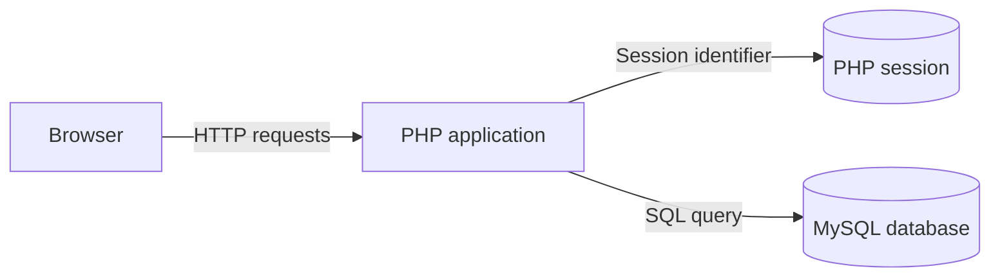
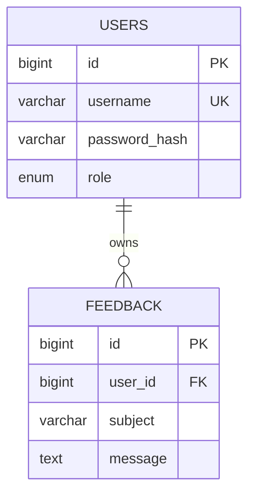

# Security architecture

## Trust boundaries

The client browser is untrusted. Both application versions use PHP and a common MySQL schema, but the insecure version exists only for controlled local demonstrations. The secure version maintains authentication in server-side PHP sessions and authorises data operations using the authenticated account's identifier.

## Data ownership

Users register and authenticate using password hashes. Feedback records reference a specific user through `user_id`. This application is **account-linked feedback, not an anonymous reporting service**: administrators can identify submitters.

## Request security

1. Authentication uses a prepared SQL query, password verification and session ID regeneration.
2. The hardened application restricts personal feedback reads and mutations by session owner ID.
3. State-changing requests require a CSRF token.
4. Output encoding prevents submitted feedback from being interpreted as executable HTML.
5. Administrative pages check the role server-side.
6. Content Security Policy, clickjacking protection, cookie attributes and idle expiration supplement application controls.
7. Database credentials are provided through the runtime environment instead of hardcoded source.

## Verification

The PHP/MySQL regression workflow starts two loopback servers and a disposable database, then exercises both versions using separate test accounts. It verifies SQL injection, stored XSS and IDOR in the baseline and checks the corresponding defences in the hardened version. A separate Semgrep workflow scans the hardened PHP sources. These checks do not replace authenticated OWASP ZAP testing or manual review.

## Limitations

The session-based login lockout is not a distributed account-level rate limiter. HTTPS and operational protection are required before any deployment. The insecure application must never be exposed publicly.
